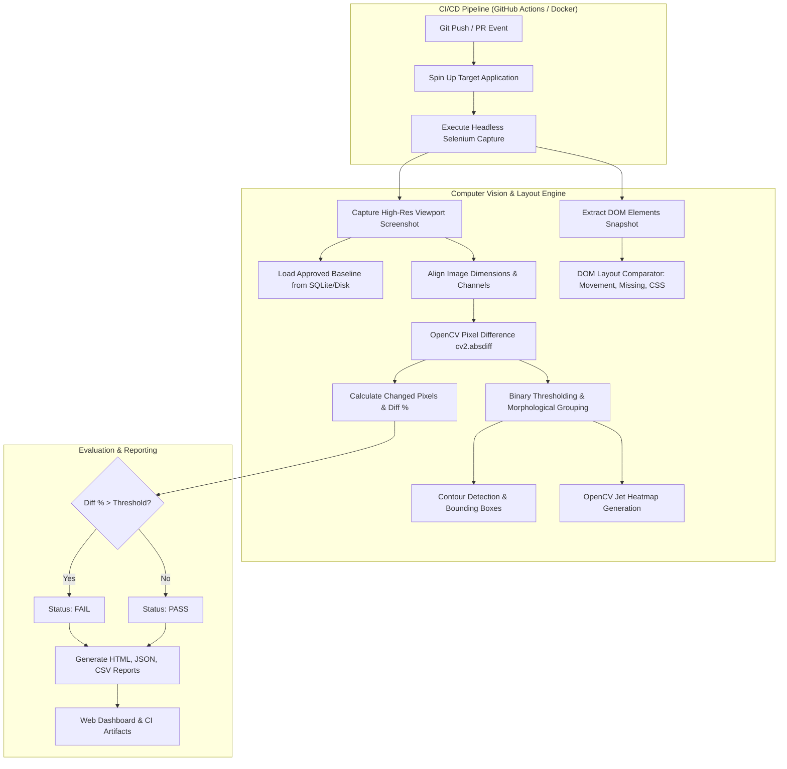

# Vision-Based Screen Layout Analysis and Visual Regression Testing Framework for CI/CD Pipelines

[](https://github.com/192425155KVijayBhsakarReddy/AI-Screen-Analyzer/actions/workflows/visual-regression.yml)
[](https://www.python.org/downloads/)
[](https://opencv.org/)
[](https://www.selenium.dev/)
[](https://www.docker.com/)

A professional, vision-based visual regression testing framework and web management platform. The system automatically captures pixel-accurate screenshots across configurable viewports (desktop, laptop, tablet, mobile), extracts DOM structural geometry, performs pixel-difference analysis, calculates Structural Similarity Index (SSIM), highlights defects via bounding-box overlays and false-color heatmaps, and integrates directly with CI/CD automation pipelines.

---

## 1. System Architecture



---

## 2. Key Capabilities

- **Mathematical Vision Comparison**:
  $$\text{Difference Percentage} = \left(\frac{\text{Changed Pixels}}{\text{Total Viewport Pixels}}\right) \times 100$$
  Configurable tolerance threshold (default: 0.5%).
- **OpenCV Defect Overlays**: Highlights modified regions in red with indexed bounding boxes.
- **Continuous Color Heatmaps**: Uses `cv2.applyColorMap(..., cv2.COLORMAP_JET)` to map visual displacement density.
- **DOM Layout Inspection**: Detects moved elements, missing components, resized containers, and CSS property shifts.
- **Strict Baseline Governance**: Baselines are committed and immutable. A failed test **never** replaces a baseline automatically; explicit approval via the dashboard is mandatory.
- **Exclusion Regions**: Supports masking dynamic areas (timestamps, advertisements, live counters).
- **Multi-Format Reports**: Interactive standalone HTML reports, structured JSON data packets, and CSV audit summaries.
- **Professional Web Dashboard**: Light-theme software testing UI with dark navy sidebar, Chart.js statistics, and live side-by-side screenshot comparisons.

---

## 3. Project Structure

```
AI-Screen-Analyzer/
├── .github/
│   └── workflows/
│       └── visual-regression.yml       # GitHub Actions CI/CD automation workflow
├── ai_screen_analyzer/                 # Preserved original screen telemetry system
├── visual_regression/                  # Visual Regression Testing Framework
│   ├── app.py                          # Flask Web Dashboard entry point
│   ├── config.py                       # Configuration, directories, viewports
│   ├── database.py                     # SQLite schema, tables, and indexes
│   ├── cli_runner.py                   # Automated CI/CD headless test executor
│   ├── requirements.txt                # Pinned dependencies
│   ├── capture/
│   │   ├── browser_manager.py          # Selenium Chrome/Chromium manager
│   │   └── screenshot_capture.py       # High-resolution screenshot & DOM capture
│   ├── vision/
│   │   ├── image_processor.py          # OpenCV image loading, decoding & padding
│   │   ├── visual_comparator.py        # Pixel diff, contours & bounding boxes
│   │   ├── heatmap_generator.py        # Jet false-color heatmap generator
│   │   └── layout_analyzer.py          # DOM element geometry comparator
│   ├── services/
│   │   ├── baseline_service.py         # Baseline management & approval logic
│   │   └── test_service.py             # Test execution orchestration & persistence
│   ├── routes/
│   │   ├── dashboard.py                # Dashboard & summary metrics
│   │   ├── applications.py             # Application registry routes
│   │   ├── testing.py                  # Test execution, comparison & history routes
│   │   ├── baselines.py                # Baseline capture, upload, and approval
│   │   └── reports.py                  # HTML/JSON/CSV report downloads
│   ├── templates/                      # Bootstrap 5 responsive templates
│   ├── sample_app/                     # Target sample application for testing
│   │   ├── app.py                      # Sample Flask portal with regression toggle
│   │   └── templates/                  # Sample HTML templates (Homepage, Login)
│   └── tests/                          # Automated Pytest suite
│       ├── test_vision_engine.py       # Unit tests for CV algorithms
│       ├── test_webapp_routes.py       # Route & database integration tests
│       └── test_browser_integration.py # Headless browser screenshot tests
├── Dockerfile                          # Multi-stage Docker container specification
├── docker-compose.yml                  # Compose definition for dashboard + sample app
├── .dockerignore                       # Docker exclusion rules
└── README.md                           # Comprehensive documentation
```

---

## 4. Local Setup & Execution (Windows PowerShell)

### Prerequisites
- Python 3.11+
- Google Chrome installed on system
- Git

### Step 1: Install Dependencies
```powershell
cd C:\Users\vijay\AI-Screen-Analyzer
python -m pip install -r visual_regression/requirements.txt
```

### Step 2: Run Automated Test Suite
```powershell
$env:PYTHONPATH="C:\Users\vijay\AI-Screen-Analyzer"
python -m pytest visual_regression/tests -v
```

### Step 3: Start Target Sample Application
In a separate terminal:
```powershell
$env:PYTHONPATH="C:\Users\vijay\AI-Screen-Analyzer"
python visual_regression/sample_app/app.py
```
*The sample application is accessible at `http://127.0.0.1:5001`.*

### Step 4: Start Web Dashboard
In another terminal:
```powershell
$env:PYTHONPATH="C:\Users\vijay\AI-Screen-Analyzer"
python visual_regression/app.py
```
*The Dashboard is accessible at `http://127.0.0.1:5000`.*

---

## 5. Visual Regression Demonstration

### Baseline Capture & Unchanged Test (PASS)
Run the automated CLI runner against the initial unmodified sample application:
```powershell
$env:PYTHONPATH="C:\Users\vijay\AI-Screen-Analyzer"
python visual_regression/cli_runner.py --app-url "http://127.0.0.1:5001" --threshold 0.5
```
**Result**: `PASS` (Difference: `0.0%`, Defects: `0`).

### Modified / Regressed UI Test (FAIL)
Run the test against the modified UI (button color changed to red, header misaligned, signup element removed):
```powershell
$env:PYTHONPATH="C:\Users\vijay\AI-Screen-Analyzer"
python visual_regression/cli_runner.py --app-url "http://127.0.0.1:5001/?mode=regressed" --threshold 0.5
```
**Result**: `FAIL` (Difference: `9.27%`, Exceeds `0.5%` threshold, `47` visual & DOM defects flagged).

---

## 6. Docker Deployment

Deploy the entire suite (Dashboard + Sample App) inside isolated Linux containers:

```powershell
# Build Docker images
docker compose build

# Start services in background
docker compose up -d

# View live logs
docker compose logs -f

# Access:
# - Dashboard:   http://localhost:5000
# - Sample App:  http://localhost:5001

# Stop containers
docker compose down
```

---

## 7. CI/CD GitHub Actions Pipeline

The workflow located at `.github/workflows/visual-regression.yml` automatically triggers on `push` and `pull_request` to `main`:
1. Sets up Python 3.11 and installs Chromium + ChromeDriver on Ubuntu.
2. Runs the full Pytest unit and integration suite.
3. Spawns the sample web application.
4. Executes the headless visual regression CLI runner.
5. Emits `PASS` (exit code 0) or `FAIL` (exit code 1) based on visual tolerance.
6. Uploads interactive HTML reports, difference overlays, and heatmaps as downloadable workflow artifacts.
